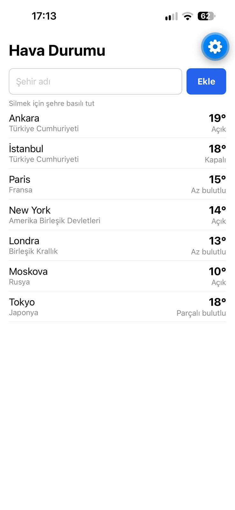

# Hava Durumu

[Open-Meteo](https://open-meteo.com/)'dan anlık hava durumu gösteren, şehir listesini telefonda saklayan Expo (React Native) uygulaması.



## Özellikler

- Şehir adıyla arama ve listeye ekleme (Open-Meteo Geocoding API)
- Her şehir için anlık sıcaklık ve Türkçe hava durumu açıklaması (Open-Meteo Forecast API)
- Aynı şehrin iki kez eklenmesini engelleme
- Şehre basılı tutarak silme
- Uygulama kapatılıp açılsa da listenin korunması (AsyncStorage)
- Yükleniyor, hata (internet yok) ve boş liste durumları
- Listeyi aşağı çekerek hava durumunu yenileme

## Kurulum

Gereksinimler: Node.js ve telefonda [Expo Go](https://expo.dev/go) (SDK 58).

```bash
git clone https://github.com/0Ens/development-11-rol-turu-mobile.git
cd development-11-rol-turu-mobile
npm install
npx expo start
```

Terminalde çıkan QR kodu telefonun kamerasıyla (iOS) veya Expo Go ile (Android) okut. Telefon ve bilgisayar aynı Wi-Fi ağında olmalı.

## Kullanım

1. Üstteki kutuya bir şehir adı yaz ve **Ekle**'ye bas.
2. Şehir, sıcaklığı ve hava durumuyla birlikte listeye eklenir.
3. Silmek için şehre **basılı tut**.
4. Hava durumunu yenilemek için listeyi **aşağı çek**.

## Testler

```bash
npm test
```

Testler yalnızca `src/core` içindeki saf (React Native'e bağımlı olmayan) fonksiyonları kapsar: hava kodu çevirisi, API cevabı dönüştürücüleri ve şehir ekleme/silme/tekrar engelleme mantığı.

## Proje yapısı

```
App.js                    Ana ekran: şehir ekleme, liste, silme, yenileme
src/
  core/                   Saf fonksiyonlar (React Native import'u yok, testli)
    weatherCodes.js       Hava kodu → Türkçe açıklama
    transform.js          API cevabı → uygulama modeli
    cities.js             Şehir listesi ekleme/silme
    __tests__/            Jest testleri
  api/openMeteo.js        Open-Meteo istekleri
  storage/cityStorage.js  AsyncStorage ile kaydetme/yükleme
  components/CityRow.js   Tek bir şehir satırı ve hava durumu
```

## Ne öğrendim

- **Saf fonksiyonları ayırmak test yazmayı kolaylaştırıyor.** Hava kodu çevirisini, API dönüştürücülerini ve şehir ekleme/silme mantığını React Native'den bağımsız `src/core` klasörüne koydum. Bu sayede hiçbir şeyi taklit etmeden (mock) test edebildim. `toCity` için yazdığım testler, kodumda `results` yerine yanlış alanı okuduğum ve bulunamayan şehirde `null` yerine `false` döndürdüğüm hataları yakaladı. Bir testi bilerek bozup kırmızıya döndüğünü görmek, testin gerçekten bir şeyi kontrol ettiğinden emin olmamı sağladı.

- **`catch` sadece internet hatalarını değil, her hatayı yakalıyor.** `CityRow` içinde yanlışlıkla bu dosyada olmayan `setCities`'i çağıran bir satır kalmıştı. Bu bir `ReferenceError` fırlatıyordu ve `catch` bunu yakalayıp ekrana "Bağlantı yok" yazardı. İnternet çalışırken bile hata görürdüm ve sebebini bulmakta zorlanırdım. `try` bloğunun içini temiz tutmam gerektiğini öğrendim.

- **`fetch` her hatada hata fırlatmıyor.** Uçak modunda hata fırlatıyor, ama sunucu 404 veya 500 döndürdüğünde döndürmüyor. Bu yüzden `response.ok` değerini kendim kontrol etmem gerekiyor. Ayrıca Open-Meteo, şehir bulunamadığında boş bir liste değil, içinde `results` alanı hiç olmayan bir cevap döndürüyor. Bunu `?.` ile güvenli şekilde okudum.

- **Dış API'ye verdiğim girdi belirsizse beklediğim cevabı alamayabilirim.** Kutuya sadece "De" yazıp Ekle'ye bastığımda listeye Japonya'dan "Demachi-chuo" eklendi. Geocoding API benzer sonuçları arıyor, biz de `count=1` ile ilk sonucu kabul ediyoruz. Kullanıcının ne eklendiğini anlayabilmesi için şehrin altına ülkesini de yazdırdım.

- **React Native web değil.** `div` yerine `View`, `onClick` yerine `onPress`, CSS sınıfları yerine `StyleSheet` kullanılıyor. Yazı mutlaka `<Text>` içinde olmalı, boyutlar `"56"` gibi tırnaklı değil `56` gibi sayı olarak yazılmalı. Bir stil nesnesini yanlışlıkla başka bir stilin süslü parantezinin içine yazdığımda `styles.input` `undefined` oldu ve kutunun çerçevesi kayboldu. `StyleSheet.create` dışında ayrı bir nesneye yazdığım stiller de hiç uygulanmadı.

- **`{x && <Text/>}` yerine ternary kullanmak daha güvenli.** Değer boş string (`""`) olursa React Native onu `<Text>` dışında bir yazı olarak basmaya çalışıp çökebiliyor. `x ? <Text/> : null` her zaman güvenli.

- **`onLongPress={handleRemove(id)}` ile `onLongPress={() => handleRemove(id)}` farklı şeyler.** İlki fonksiyonu satır çizildiği anda çalıştırır, ikincisi ise basıldığında çalışacak bir fonksiyon verir.

- **State'i doğru zamanda sıfırlamak gerekiyor.** Pull-to-refresh'te yenilemeye başlamadan önce `setError(null)` yapmazsam, bir kere "Bağlantı yok" gördükten sonra internet geri gelse bile hata yazısı ekranda kalıyordu. `useEffect`'in bağımlılık listesine `refreshKey` ekleyerek bir sayacı artırmanın satırları yeniden yüklettiğini gördüm.

- **Ekran beklediğim gibi değilse önce uygulamayı yeniden yüklemeliyim.** Fast Refresh state'i korumaya çalıştığı için, kod doğru olduğu halde sıcaklıklar görünmüyordu. Terminalde `r`'ye basınca düzeldi. Uçak modunu test ederken de telefonun kodu bilgisayardan Wi-Fi ile aldığını, bu yüzden internet kapalıyken `r` komutunun telefona ulaşmadığını öğrendim. Hatayı görmek için uygulamanın içinden yeni bir istek atmak (Ekle'ye basmak veya listeyi aşağı çekmek) gerekiyordu.

- **Expo sürümleri önemli.** Telefonumdaki Expo Go SDK 58'e güncellenince proje açılmadı. `npx expo install expo@^58.0.0` ve `npx expo install --fix` ile projeyi yükselttim. Paketleri `npm install` yerine `npx expo install` ile kurmanın, SDK ile uyumlu sürümleri seçtiğini öğrendim.

- **Git geçmişi küçük ve anlamlı adımlardan oluşmalı.** Her özelliği ayrı bir commit olarak attım (`feat:`, `test:`, `chore:`, `refactor:`). Bir keresinde iki değişikliği aynı commit'e koyduğumda, "önce commit at, sonra yeni adıma geç" kuralının önemini anladım. Terminal komutlarında argümanların virgülle değil boşlukla ayrıldığını da öğrendim.
